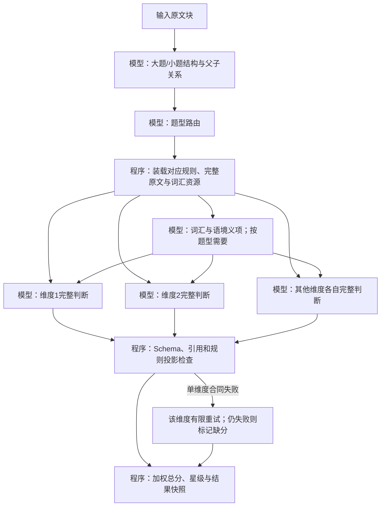

# 高考英语难度计算链路

这是一个可在本地运行的英语题目难度计算原型。它先识别大题与小题、建立题型路由，再由独立模型节点逐维度给出原文证据、指标、分档及当前分值依据，最后由程序检查合同并计算加权总分和星级。模型固定为 **豆包 2.0 mini**，不配置其他模型回退。

目前包含 11 个启用题型、58 个评分维度；听力选择和听力填空尚未接入。规则、模型参数、提示词、JSON Schema 和词汇资源均存放在外部文件。项目不依赖数据库或业务审核系统。

> **状态：研究与调试原型。** 离线测试覆盖结构、引用、规则边界和计算合同，不能证明模型的教学语义判断准确。最近一次五道争议题调试中，只有三道形成完整总分，且这三道的星级均未与人工标注一致。这组题已参与开发，不能作为独立验证集。请勿把输出直接作为正式教学结论。

## 获取与运行

需要 Python 3.11+。克隆仓库后在仓库根目录运行；核心链路没有第三方运行时依赖。

```bash
git clone https://github.com/Yolanda-Y3/english-difficulty-pipeline.git
cd english-difficulty-pipeline
python -m english_difficulty.cli check
python -m unittest discover -s tests -v
```

真实调用需要自己的火山方舟 `ARK_API_KEY`。Windows PowerShell 示例：

```powershell
$env:ARK_API_KEY = "你的密钥"
./run.ps1 run -InputFile ./examples/synthetic_grammar.txt -Live -MaxCalls 30
```

macOS/Linux 示例：

```bash
export ARK_API_KEY="你的密钥"
python -m english_difficulty.cli run --input examples/synthetic_grammar.txt --live --max-calls 30
```

`check` 与单元测试不会调用模型。`run` 必须显式传入 `--live`；每次运行在 `runs/` 下创建新目录，不覆盖已有结果。默认每批最多 100 次模型请求，每节点最多尝试 2 次。大批量任务可查看 `tools/run_batch.py --help`，按文档准备 JSON 输入和独立输出目录。

输入支持 UTF-8 TXT、JSON、JSONL。TXT 整体作为一个原文块；JSONL 每行一个文档。JSON 示例：

```json
{
  "id": "exam-001",
  "blocks": [
    {"id": "passage-1", "text": "文章、题干和选项原文……"}
  ],
  "metadata": {"source": "自有题库"}
}
```

PDF/DOCX 需要由上游采集程序转换为 `blocks`；本仓库不包含采集界面或私有题库。输入文档、模型输出与运行快照都保存在本地，不会提交到仓库。调用方需自行管理模型费用与密钥。

## 节点流程



每个维度是独立的完整模型节点，**同一次调用**提交事实、引用、指标、原规则档位、分数和 `score_basis`。同一道题的维度目前依次调度；批量文档可以并发。程序只检查输出形状、来源引用、计数及确定性数值规则，不用关键词猜测教学语义。缺少某维度时，其余维度继续，并按已有可用权重归一化；结果会标出 `complete`、`partial`、`unavailable` 或 `unsupported`。

方舟请求采用服务端严格 JSON Schema。严格 Schema 可以约束字段及类型，不能保证语义判断或引文内容正确；本地引用检查与有限重试也不能替代独立教学评测。

## 目录

| 路径 | 内容 |
|---|---|
| `english_difficulty/` | 装载、合同检查、调度、投影、方舟调用、CLI |
| `config/pipeline.json` | 模型、请求上限、星级边界、资源和提示词配置 |
| `config/routes.json`、`config/rubrics/` | 题型及逐维度评分规则 |
| `prompts/` | 公共、结构、路由、词汇和各维度提示词 |
| `schemas/` | 输入与模型节点 JSON 合同 |
| `resources/` | 3500 词频、熟词僻义样例、通用规则及词典接入口 |
| `examples/` | 自编合成输入，仅用于链路演示 |
| `tests/` | 离线合同与计算测试 |
| `tools/import_resources.py` | 可选的原始资料重新导入工具 |
| `tools/run_batch.py` | 批量与同版本恢复工具 |

日常调整提示词、模型参数、评分阈值或资源，应修改对应外部文件并提高配置版本；不要改动旧运行快照。重新导入资源需要自备原始资料以及 `openpyxl`、`pdfplumber`，使用 `python tools/import_resources.py --source-dir <目录>`。先在仓库副本检查导入差异；该工具会覆盖现有规则与词汇 JSON。

## 已知边界

- 课标词频按项目资源中记录的考频判定：`>26` 为高频，`<10` 为低频，10–26 为中间频段；不根据新语料重排百分位。
- 熟词僻义资源只有 28 词样例，不是完整词典。样例外词仍由模型结合上下文判断，结果不会伪称有词典义项编号。
- 个别原表五档描述未覆盖所有可能组合；链路保留不可计算原因，不自行补阈值。
- 语义评分仍有较大人工偏差；使用前需要独立金标集和题型覆盖评测。

配置资源由提供给本项目的 Excel/PDF 整理，原始文档及真实测试题未随仓库发布。请在重新分发或替换教学资料时核实相应资料的使用权限。

## 许可

仓库代码及项目自编配置采用 [MIT License](LICENSE)。第三方原始资料的权利不因本仓库许可而转移。
